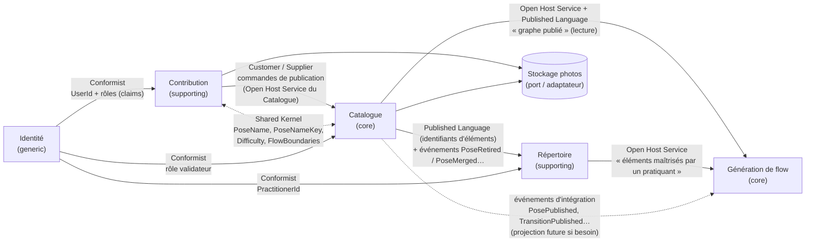

# Carte des contextes

Version initiale du 2026-11-02, avant la première user story. Les contextes seront créés au fil des stories avec `/new-bounded-context`. Décisions de découverte : `decouverte.md`. Mise à jour du 2026-11-03 (story 3 « Proposer une pose ») : création de Contribution, noyau partagé avec le Catalogue, publication directe.

Déploiement : **monolithe modulaire**. Une seule API et une seule base de données, un module par contexte (dossiers ou namespaces dans chaque couche, schémas de base séparés). Aucun contexte ne référence les types internes d'un autre.

| Contexte | Type (core / supporting / generic) | Responsabilité | Équipe |
|---|---|---|---|
| **Catalogue** (`Catalog`) | core | Graphe **publié** des poses et des transitions, avec la liste fermée des étiquettes et les photos publiées. Garantit la cohérence du graphe : une transition relie deux poses existantes et ses étiquettes appartiennent à la liste. Seule source de vérité de ce qui est publié. | unique |
| **Génération de flow** (`FlowGeneration`) | core | Tirer au hasard un chemin exécutable dans le graphe publié selon des critères (difficulté, longueur, étiquettes), ou répondre explicitement « critères trop restrictifs ». | unique |
| **Répertoire** (`Repertoire`) | supporting | Ce que chaque pratiquant déclare maîtriser (poses, transitions) : déclaration et retrait d'une maîtrise, consultation de son répertoire. Fournit à la génération l'ensemble des éléments maîtrisés par un pratiquant. | unique |
| **Contribution** (`Contribution`) | supporting | Cycle de vie des propositions (ajout, modification, ajout de photos) : soumission, file de validation, acceptation ou refus par un validateur. Déclenche la publication dans le catalogue. | unique |
| **Identité** (`Identity`) | generic | Comptes, authentification (déléguées à ASP.NET Core Identity, ADR 0008), et règles produit des rôles : un rôle ordonné par compte, capacités, attribution et retrait, au moins un administrateur, amorçage du premier administrateur. | unique |
| _Stockage des photos_ | generic (pas un contexte) | Stocker et servir les fichiers image. C'est un **port** (`IPhotoStorage`) et un adaptateur d'infrastructure (stockage blob), pas un contexte métier. | unique |

Lecture : la flèche va de l'amont (upstream) vers l'aval (downstream), sauf la relation Contribution → Catalogue, où Contribution est le client (customer) qui invoque le service publié par le Catalogue (supplier).

## Relations

### Contribution → Catalogue : Customer / Supplier, via l'Open Host Service du Catalogue
- Quand un validateur **accepte** une proposition, le cas d'usage `AcceptProposal` de Contribution appelle un port `ICatalogPublisher` (défini dans Contribution.Application). Son adaptateur (Infrastructure, couche anti-corruption) traduit la proposition en commande du Catalogue : `PublishPose`, `PublishTransition`, `RevisePose`, `AttachPhotos`…
- Le Catalogue **reste maître de ses invariants** : il peut refuser la publication (pose de départ disparue, étiquette retirée entre-temps, nom en doublon…). L'acceptation échoue alors avec un `Result` en erreur, et la proposition reste « en attente de validation ». Choix d'un appel synchrone, dans le même processus, plutôt que d'un événement `ProposalAccepted` consommé à terme : on évite l'état incohérent « acceptée mais non publiable », qu'il faudrait compenser.
- Le Catalogue ne connaît pas les propositions. Il reçoit seulement la référence de la proposition d'origine (`SourceProposalId`) pour la traçabilité.
- **Publication directe (story 3)** : le cas d'usage `ProposePose` d'un validateur ou d'un administrateur crée une `PoseProposal` acceptée aussitôt, puis appelle `ICatalogPublisher.PublishPose` **dans la même transaction** (même `DbContext`, deux schémas). Si le Catalogue refuse, rien n'est enregistré. C'est une exception assumée à « une commande, un agrégat », pour la même raison que l'acceptation.
- **Unicité du nom à travers les deux contextes** : la clé de comparaison (`PoseNameKey`, noyau partagé) est stockée dans `catalog.poses` (index unique) et dans `contribution.pose_proposals` (index unique partiel sur les propositions en attente). Contribution interroge le Catalogue par un port `ICatalogPoseNames` (ACL, qui appelle la query `IsPoseNamePublished` du Catalogue) avant de soumettre ; un verrou transactionnel par clé (`pg_advisory_xact_lock`) sérialise les propositions concurrentes d'un même nom. Le Catalogue revérifie à la publication.
- Les adaptateurs qui relient deux contextes (`ICatalogPublisher`, `ICatalogPoseNames`, `IContributors`) vivent dans un espace de noms d'intégration de l'Infrastructure (`AcroFunJam.Infrastructure.ContextIntegration`), hors de tout espace de noms de contexte : c'est la seule couche qui voit les deux côtés.

### Catalogue ⇄ Contribution : Shared Kernel (story 3)
- Le contenu d'une pose (`PoseName`, `PoseNameKey`, `DifficultyLevel`, `Difficulty`, `FlowBoundaries` et leurs erreurs `pose.*`) vit dans `AcroFunJam.Domain.SharedKernel`, côté front dans `core/src/domain/shared-kernel`. Raison : l'unicité du nom s'apprécie à travers les deux contextes avec **la même** clé, et une pose proposée doit être publiable telle quelle. Une duplication dériverait précisément sur l'invariant commun.
- Le noyau reste minimal, sans agrégat ni dépendance vers un contexte. Le Catalogue en est le propriétaire (core) ; une seule équipe, donc un coût de coordination nul.

### Identité → Contribution : Conformist, via un port
- Contribution ne lit jamais le rôle dans les claims. Le port `IContributors` (Contribution.Application) renvoie un `Contributor` (`ContributorId`, `IsValidator`), lu au moment de la proposition. L'adaptateur interroge le rôle **courant** du compte (même source que les policies) et traduit la capacité `ValidateProposals` en `IsValidator`. La règle « la proposition d'un validateur est publiée directement » reste dans l'agrégat `PoseProposal`.

### Langage publié du Catalogue (à partir de la story 1)
- `GET /catalog/poses` renvoie toujours `200 { "poses": [ { "id", "name", "baseDifficulty", "flyerDifficulty", "canStartFlow", "canEndFlow" } ] }`. Les deux booléens obligatoires sont ajoutés par la story « Proposer une pose » (refonte de la liste, 2026-11-03), sans casser le contrat : les difficultés restent à plat. Le nombre de poses se déduit de la liste (pas de champ `count` tant qu'il n'y a pas de pagination). Si le catalogue est vide, la réponse est `poses: []` (jamais 204 ni 404).
- Les niveaux de difficulté circulent sous forme de **codes stables** : `discovery | beginner | intermediate | advanced`. Les libellés français (découverte, débutant, intermédiaire, avancé) relèvent de la présentation et sont produits côté front (`@acrofunjam/core`).
- L'ordre de la liste est garanti par l'API, selon l'ordre du catalogue défini par le domaine (`PoseNameKey`, puis le nom exact). Le front ne trie pas.
- Côté lecture, un port de lecture (`IPublishedPosesReader`) projette directement le modèle de lecture (CQRS léger). Côté écriture, l'agrégat `Pose` naît avec la story « Proposer une pose » (commande `PublishPose`, événement `PosePublished`), utilisée par la publication directe, puis par l'acceptation et un éventuel seeder de démonstration.

### Langage publié de Contribution (story 3)
- `POST /contribution/pose-proposals` (capacité `CanPropose`) : corps `{ "name", "baseDifficulty", "flyerDifficulty", "canStartFlow", "canEndFlow" }`, réponse `201 { "id", "status": "pending" | "accepted", "name", "baseDifficulty", "flyerDifficulty", "canStartFlow", "canEndFlow" }`. Un contenu irrecevable donne 400 et un nom déjà pris 409, en ProblemDetails avec le code stable dans `title`. Un visiteur reçoit 401. Un compte supprimé depuis la connexion reçoit aussi 401 : `identity.account-deleted` si la policy le détecte, `contribution.unknown-contributor` si le cas d'usage le détecte (ADR 0018).

### Catalogue → Génération de flow : Open Host Service + Published Language
- La génération possède **son propre modèle minimal** du graphe (`FlowGraph` : nœuds avec `CanStartFlow` / `CanEndFlow` et une difficulté, arêtes orientées avec une difficulté et des étiquettes), sans nom, description ni photo.
- Elle l'obtient via un port `IPublishedGraphSource`. L'adaptateur (ACL) lit le langage publié du Catalogue, c'est-à-dire le DTO « graphe publié ». Dans un premier temps, c'est une requête directe ; plus tard, ce pourra être une projection alimentée par les événements `PosePublished`, `TransitionPublished`, `PoseRevised`… si les performances l'exigent.
- La génération ne modifie jamais le catalogue.

### Catalogue → Répertoire : Published Language (identifiants) + événements
- Le Répertoire ne stocke que des **références** d'éléments du catalogue (`PoseId`, `TransitionId`), jamais leur contenu. L'affichage « liste à cocher » se fait par composition côté lecture : catalogue publié + maîtrises du pratiquant.
- Déclarer maîtriser un élément exige qu'il soit publié. Le cas d'usage vérifie cela via un port `IPublishedCatalogItems` (ACL vers le Catalogue). L'invariant « pas de doublon de maîtrise » reste dans l'agrégat `Repertoire`.
- Les événements de cycle de vie du catalogue (retrait, fusion, si ces notions apparaissent) sont consommés à terme par le Répertoire pour retirer ou réaffecter des maîtrises. La règle n'est pas tranchée.

### Répertoire → Génération de flow : Open Host Service
- La génération demande, via un port `IMasteredItemsSource`, les éléments maîtrisés par chaque membre du duo (et par rôle si la maîtrise est déclarée par rôle). Elle en déduit un **ensemble d'éléments autorisés**, puis restreint son `FlowGraph` avant la recherche de chemin.
- La règle de combinaison (intersection, ou chacun dans son rôle) est une **règle de génération** : elle vit dans le domaine `FlowGeneration` (value object `Duo` / spécification de restriction), pas dans le Répertoire.

#### Pourquoi un contexte Répertoire, et non la maîtrise dans la génération ou dans le catalogue
- **Dans la génération ?** Non. La maîtrise a son propre cycle de vie (déclarer, retirer, consulter), indépendant de toute génération, et elle sera probablement réutilisée ailleurs (filtrer le catalogue, suivre sa progression). La génération resterait alors un calcul sans état (`FlowGenerator`), qui reçoit des données.
- **Dans le catalogue ?** Non. Le catalogue est un contenu partagé et modéré. La maîtrise est une donnée **personnelle**, par pratiquant, potentiellement privée (RGPD), avec une volumétrie et des accès concurrents sans rapport avec le catalogue. La mélanger alourdirait les agrégats `Pose` et `Transition`.
- **Type supporting** : c'est utile et cela rend le générateur personnel, mais la valeur différenciante reste le graphe et la génération.

### Identité → autres contextes : Conformist
- Les contextes ne manipulent que des identifiants typés (`ContributorId`, `ValidatorId`, `PractitionerId`) et des rôles issus des claims. Aucun profil utilisateur riche dans les contextes métier.

## Option pesée : modération en contexte séparé ou cycle de vie dans le Catalogue

| | A. Contexte **Contribution** séparé (recommandé) | B. Cycle de vie brouillon / proposé / publié **dans le Catalogue** |
|---|---|---|
| Modification d'un élément publié | La version publiée reste intacte. La proposition porte les changements demandés, appliqués à l'acceptation. | L'agrégat `Pose` doit porter la version publiée **et** n versions en attente : agrégat gros, contentieux sur les accès concurrents, invariants mélangés. |
| Langage | Deux langages distincts et nets : « proposer / accepter / refuser » d'un côté, « publier / réviser » de l'autre. | Le statut s'infiltre partout : chaque requête du catalogue et de la génération doit filtrer « publié ». Risque de fuite de contenu non validé dans un flow. |
| Ajout de photos et propositions multiples sur un même élément | Ce sont des propositions de types différents, gérées par un seul mécanisme. | Il faut un statut par photo et par champ modifié. |
| Coût | Un module de plus, et une traduction proposition → commande du Catalogue (ACL). | Moins de code au départ. |
| Évolution (historique, crédit, fusion de doublons) | Naturellement porté par les propositions acceptées. | Il faudrait ajouter un versionnement dans le cœur. |

**Recommandation : A.** Le Catalogue ne contient que du publié, ce qui simplifie radicalement la génération et la consultation, et les agrégats du cœur restent petits. Contribution est *supporting* : elle est nécessaire, mais ce n'est pas elle qui différencie le produit. Le coût de A est limité dans un monolithe modulaire.

Conséquence à assumer : tant que la contribution n'existe pas, le Catalogue doit pouvoir être alimenté directement, par un validateur ou par un amorçage de données. Les commandes `PublishPose` / `PublishTransition` du Catalogue existent donc indépendamment de Contribution. C'est ce qui permet un *walking skeleton* sans le circuit de validation.

## Identité et comptes (generic, ADR 0008)
On ne modélise pas l'authentification. Inscription, connexion, jetons, hachage et règles de mot de passe, unicité et normalisation de l'adresse sont **délégués à ASP.NET Core Identity** et exposés tels quels sous `/identity` (`MapIdentityApi`). La consultation du catalogue reste anonyme.

**Ce qui relève de notre domaine** (`AcroFunJam.Domain/Identity`) :
- `Role`, un *smart enum* ordonné (User < Validator < Administrator), qui porte la correspondance rôle → capacités (`Capabilities`, `Grants(capability)`) ;
- `Capability` ;
- `EmailAddress` ;
- l'agrégat `Account` (`AccountId`, `EmailAddress`, `Role`). Il ne sait pas authentifier : il ne porte que la vue « rôle » du compte, et ses comportements protègent les règles de rôle (`AssignRole`, `RevokeRole`, `PromoteAsInitialAdministrator`, événements `RoleAssigned` / `RoleRevoked`).

**Ce qui relève de l'Infrastructure** : `ApplicationUser` (utilisateur ASP.NET Core Identity avec une colonne `Role`, sans les tables de rôles d'Identity), le `IdentityDbContext` (schéma `identity`), et l'`AccountRepository`, qui reconstitue un `Account` à partir d'un `ApplicationUser`.

**Invariant « au moins un administrateur »** : il est vérifié par `Account` à partir du nombre d'administrateurs fourni par le handler (`IAccountRepository.CountAdministrators`). Les changements de rôle s'exécutent dans une transaction `Serializable` (PostgreSQL), pour que deux rétrogradations simultanées ne puissent pas passer toutes les deux.

**Capacités dans l'Api** : des policies `CanPropose`, `CanValidate` et `CanManageRoles` sont évaluées par un handler d'autorisation. Il relit le rôle courant via un port à chaque évaluation et applique `Role.Grants`. Le rôle figé dans le jeton n'est jamais utilisé.

**Langage publié pour les clients (story 2b)** :
- `/identity/*` : les réponses de la bibliothèque, figées par des tests de contrat d'`AcroFunJam.Api.Tests` (clés `DuplicateEmail` / `DuplicateUserName` / `PasswordTooShort` / `InvalidEmail` de la `ValidationProblem`, 401 avec le détail `Failed` ou `LockedOut`) ;
- `POST /identity/logout` (le nôtre, anonyme, 204) ;
- `GET /me`.

Le site s'authentifie par cookie (`?useCookies=true`), le mobile par jeton porteur. L'adaptateur `createAuthGateway` (api-client) est la couche anti-corruption qui traduit ces réponses en erreurs typées du port `AuthGateway` de `@acrofunjam/core`.

Les autres contextes ne voient que `UserId` (et ses alias `ContributorId`, `ValidatorId`, `PractitionerId`) et des capacités. Jamais `ApplicationUser`.
